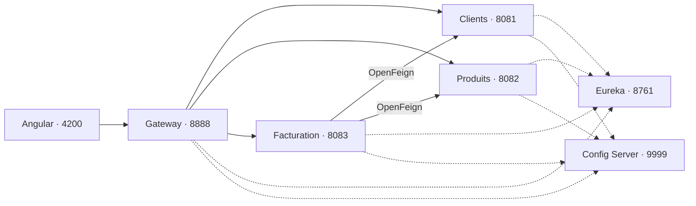

# TP 2 — Facturation avec Spring Cloud

L’application permet de consulter les clients et le catalogue, puis de créer et consulter des factures. Le client Angular accède aux trois API métier par la passerelle. Chaque service métier a sa propre base H2 en mémoire, alimentée par des données de démonstration au démarrage.

## Services

| Service | Port | Rôle |
| --- | ---: | --- |
| `discovery-service` | 8761 | Annuaire Netflix Eureka |
| `config-service` | 9999 | Configuration centralisée, avec les profils natif et Git |
| `gateway-service` | 8888 | Routage Spring Cloud Gateway et CORS |
| `customer-service` | 8081 | Gestion des clients avec Spring Data REST |
| `inventory-service` | 8082 | Gestion des produits avec Spring Data REST |
| `billing-service` | 8083 | Enregistrement des factures et agrégation via OpenFeign |
| `ecom-web-app` | 4200 | Interface Angular et Bootstrap |



## Démarrer sur Windows

Installez Java 21 et Node.js 24.15+ LTS (ou Node 22.22.3+ / 26 compatible Angular 22). Le Maven Wrapper télécharge Maven au premier lancement.

Dans un premier terminal PowerShell, depuis la racine du dépôt :

```powershell
.\mvnw.cmd clean verify
.\scripts\start-backend.ps1
```

Dans un second terminal, depuis la même racine :

```powershell
cd ecom-web-app
npm ci
npm start
```

Ouvrez [Facturation](http://localhost:4200), puis **Clients → Voir les factures → Voir le détail**. Le premier client possède deux factures de démonstration. Son écran de factures permet également d’en créer une à partir du catalogue.

Le tableau de bord [Eureka](http://localhost:8761) affiche les services enregistrés. L’apparition des routes dynamiques peut prendre quelques secondes. Les journaux se trouvent dans `target/local-logs`. Utilisez `Ctrl+C` dans les deux terminaux pour arrêter l’application. Les bases H2 sont recréées au redémarrage.

## Tester les deux modes de routage

- **Mode dynamique, par défaut.** Le locator de Spring Cloud Gateway découvre les trois services métier inscrits dans Eureka. Le préfixe du service est retiré avant transmission.
- **Mode statique.** Arrêtez le lanceur du backend, puis exécutez `.\scripts\start-backend.ps1 -StaticRoutes`. Les mêmes URL utilisent les cibles HTTP directes sur les ports 8081, 8082 et 8083. Billing continue à utiliser Eureka pour ses appels OpenFeign.

## Tester l’API

Les URL ci-dessous sont relatives à la passerelle [localhost:8888](http://localhost:8888).

| Méthode et chemin | Résultat |
| --- | --- |
| `GET /CUSTOMER-SERVICE/customers` | Clients paginés en HAL avec leurs identifiants |
| `GET /INVENTORY-SERVICE/products` | Produits paginés en HAL avec leurs identifiants |
| `GET /BILLING-SERVICE/bills?customerId=1` | Historique des factures du client 1 |
| `GET /BILLING-SERVICE/fullBill/1` | Facture n° 1, client, articles et total de **5 309,00 MAD** |
| `POST /BILLING-SERVICE/bills` | Enregistre une facture et retourne le détail avec le statut 201 |

Spring Data REST expose aussi la création, la modification et la suppression des clients et des produits. L’écran Angular lit ces deux référentiels et crée les factures via Billing.

```powershell
Invoke-RestMethod 'http://localhost:8888/BILLING-SERVICE/bills' `
  -Method Post -ContentType 'application/json' `
  -Body '{"customerId":1,"items":[{"productId":2,"quantity":2},{"productId":3,"quantity":1}]}'
```

Billing stocke `customerId` et `productId` comme références logiques. Le prix unitaire est enregistré sur chaque ligne à la création. Le total reste donc celui de la facture même si le prix catalogue évolue. Les informations courantes du client et du produit sont chargées à la lecture. Une référence supprimée reste identifiable par son ID.

## Configuration centralisée

En mode natif, Config Server lit `config-repo/` depuis la racine du projet. Pour vérifier le rechargement à chaud, modifiez la valeur de `billing.message` dans `config-repo/billing-service.properties` pendant l’exécution, puis lancez :

```powershell
Invoke-RestMethod 'http://localhost:8083/actuator/refresh' -Method Post -ContentType 'application/json' -Body '{}'
Invoke-RestMethod 'http://localhost:8888/BILLING-SERVICE/billing-config'
```

Pour utiliser le dépôt Git comme source, configurez ces variables avant de lancer les services :

```powershell
$env:SPRING_PROFILES_ACTIVE = 'git'
$env:CONFIG_GIT_URI = 'https://github.com/Marouanemounir/Practical-Activity-2-Microservices-Architecture-with-Spring-Cloud.git'
.\scripts\start-backend.ps1
```

Le serveur lit la branche `main` et le répertoire `config-repo/`. La variable `CONFIG_GIT_BRANCH` permet de choisir une autre branche. Pour revenir au profil natif, retirez la variable `SPRING_PROFILES_ACTIVE` avant de relancer le backend.

## Ressources du cours

- [Partie 1 — Services métier, Gateway et Eureka](https://www.youtube.com/watch?v=kOVHzN8I8e8)
- [Partie 2 — Facturation avec OpenFeign](https://www.youtube.com/watch?v=-iM3J_mgqlM)
- [Partie 3 — Spring Cloud Config](https://www.youtube.com/watch?v=-G2rcLMO1gQ)
- [Dépôt de référence de Mohamed Youssfi](https://github.com/mohamedYoussfi/micro-services-app)
